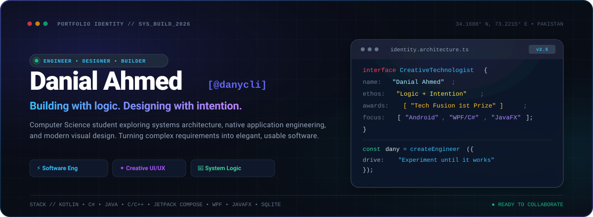
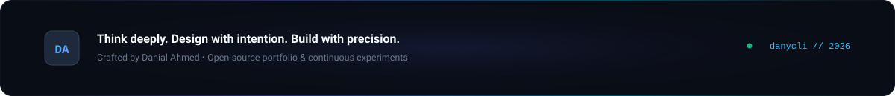

<!-- ================================================================= -->
<!-- DANIAL AHMED (DANY) — OFFICIAL GITHUB PROFILE IDENTIFIER         -->
<!-- Designed with intention • Engineered with logic                  -->
<!-- ================================================================= -->

<div align="center">

<a href="https://github.com/danycli">
  
</a>

<br/><br/>

<a href="#-who-i-am"></a>
&nbsp;
<a href="#-technical-arsenal"></a>
&nbsp;
<a href="#-featured-projects"></a>
&nbsp;
<a href="#-how-i-build"></a>
&nbsp;
<a href="#-engineering-analytics"></a>
&nbsp;
<a href="#-connect"></a>

<br/><br/>

</div>


## ⚡ Who I Am

I am **Danial Ahmed** (`@danycli`), a Computer Science student based in Abbottabad, Pakistan. My focus sits at the intersection of **low-level systems logic, native application engineering, and intentional visual design**.

I don’t treat code as an isolated exercise in syntax, nor design as cosmetic decoration. To me, software is a single unified discipline:

> **"I build things with logic, design them with intention, and keep experimenting until they work."**

<br/>

<table>
  <tr>
    <td width="33.3%" valign="top">
      <h4>⚙️ Software Engineering</h4>
      <p>Clean architectural boundaries, object-oriented paradigms, native desktop &amp; mobile runtimes, thread-safe background workers, and resilient local-first persistence.</p>
    </td>
    <td width="33.3%" valign="top">
      <h4>✦ Creative Interface Design</h4>
      <p>Modern dark-mode ergonomics, typographic rhythm, fluid cubic-bezier animations, bezel docking, and intuitive interfaces that make complex software feel effortless.</p>
    </td>
    <td width="33.3%" valign="top">
      <h4>🧪 Pragmatic Building</h4>
      <p>Zero theoretical posturing. I learn by building functional tools that solve real friction — from campus academic portals to offline Bluetooth mesh messengers.</p>
    </td>
  </tr>
</table>

<br/>


## 🛠️ Technical Arsenal

Every technology below represents tools actively deployed in my open-source projects, built systems, and engineering assignments.

<br/>

### 01. Languages & Systems Logic
```
Kotlin  •  C# (.NET 8)  •  Java  •  C  •  C++  •  Python  •  JavaScript  •  SQL
```
<p>
  
  
  
  
  
  
  
  
</p>

### 02. Application Frameworks & Native UI
- **Android Native & Jetpack Compose** — Modern reactive UI, Material 3 design systems, RemoteViews / AppWidgets, Navigation 3, and Biometric prompt integration.
- **WPF / XAML (.NET 8)** — Hardware-accelerated desktop rendering, storyboard easing physics, Win32 bezel-docking, and non-stealing focus overlays.
- **JavaFX** — Custom game loops, dynamic state machines, sprite animation engines, and transparent undecorated window architectures.

### 03. Architecture, Protocols & Persistence
- **Local Persistence**: SQLite WAL Mode (`IDbContextFactory` concurrency), Android Room DB, `EncryptedSharedPreferences`, and file serialization.
- **Wireless & Networking**: Bluetooth Low Energy (BLE GATT server/client, MTU negotiation up to 517 bytes, chunking/reassembly), OkHttp 4, and Jsoup DOM scraping.
- **System Services**: Android `WorkManager` background workers, Win32 system tray lifecycles, and AES-256 local credential cryptography.

### 04. Tooling, Packaging & Creative Direction
- **Engineering Environments**: Android Studio, IntelliJ IDEA, Visual Studio 2022, VS Code, Git.
- **Distribution & CI/CD**: Inno Setup / PowerShell native installers, GitHub Actions, semantic release tagging, ProGuard / R8 minification.
- **Visual Design**: Adobe Photoshop, Figma, vector illustration, and custom SVG interface compositions.

<br/>


## 🚀 Featured Projects

A curated selection of applications representing technical depth, original interaction design, and real-world execution.

<br/>

### 01. Assignly — COMSATS Academic Portal Client
> **🏆 1st Prize Winner • Tech Fusion 2026**  
> *A native Android client for COMSATS University Islamabad (Abbottabad Campus) eliminating clunky mobile web layouts with a high-performance native experience.*

<br/>

<p align="center">
  
</p>

<table>
  <tr>
    <td width="30%" align="center" valign="middle">
      <a href="https://github.com/danycli/Assignly">
        
      </a>
      <br/><br/>
      <a href="https://github.com/danycli/Assignly"></a>
      <br/>
      <a href="https://github.com/danycli/Assignly/releases/latest"></a>
    </td>
    <td width="70%" valign="top">
      <h4>Engineering &amp; Usability Highlights</h4>
      <ul>
        <li><b>Central Academic Dashboard:</b> At-a-glance GPA/CGPA calculations, aggregate attendance monitoring with contextual alerts, and automated scholarship detection.</li>
        <li><b>Smart Timetable Engine:</b> Live <i>"Now"</i> lecture progress bar, upcoming class countdown, offline caching, and scheduled class-start reminders.</li>
        <li><b>Automated Portal Bridge:</b> Jsoup HTML DOM scraping pipeline over OkHttp with silent background reCAPTCHA v3 verification and Cloudflare handling.</li>
        <li><b>Zero-Leak Security:</b> Biometric fingerprint/face authentication, AES-256 credential encryption via <code>EncryptedSharedPreferences</code>, and ProGuard R8 code minification.</li>
      </ul>
      <p>
        
        
        
        
      </p>
    </td>
  </tr>
</table>

<br/>

### 02. KanbanCards — Notes That Live on the Edge
> **Windows Desktop Bezel-Docked Sticky Note System**  
> *Collapsed into an orderly staircase along your screen bezel until you need it, fluid when you touch it, invisible when you game.*

<br/>

<table>
  <tr>
    <th width="50%" align="center">Collapsed Bezel State (Zero Distraction)</th>
    <th width="50%" align="center">Expanded on Hover (Instant Glance &amp; Capture)</th>
  </tr>
  <tr>
    <td align="center" valign="top">
      <a href="https://github.com/danycli/KanbanCards">
        
      </a>
      <p align="left"><sub><b>Resting State:</b> Notes stay flush against the right screen bezel. Color-coded tabs remain glanceable without obscuring active IDEs or documents.</sub></p>
    </td>
    <td align="center" valign="top">
      <a href="https://github.com/danycli/KanbanCards">
        
      </a>
      <p align="left"><sub><b>Expanded State:</b> Approaching the bezel glides the staircase stack open using cubic easing. Non-stealing focus ensures keyboard input remains uninterrupted.</sub></p>
    </td>
  </tr>
</table>

<table>
  <tr>
    <td width="30%" align="center" valign="middle">
      <a href="https://github.com/danycli/KanbanCards"></a>
      <br/>
      <a href="https://github.com/danycli/KanbanCards/releases/latest"></a>
      <br/>
      
    </td>
    <td width="70%" valign="top">
      <h4>System Architecture Highlights</h4>
      <ul>
        <li><b>Hardware-Accelerated WPF:</b> Powered by <code>EaseInOutCubic</code> storyboards and hit-test math that adapts corner radiuses and slide vectors for left or right bezels.</li>
        <li><b>Concurrency &amp; Data:</b> Embedded SQLite configured in <b>Write-Ahead Logging (WAL)</b> mode with <code>IDbContextFactory</code> handling thread-safe background autosaves.</li>
        <li><b>Zero-Friction Deployment:</b> Per-user Windows installer requiring zero UAC elevation, single-instance mutex IPC, and automatic fullscreen game suppression.</li>
      </ul>
      <p>
        
        
        
        
      </p>
    </td>
  </tr>
</table>

<br/>

### 03. GitStreakWidget — Android Native Contribution Tracker
> **Home Screen Momentum for Developers**  
> *A sleek Android-native 3×2 home screen widget and dashboard keeping your daily GitHub contribution streak visible without battery drain.*

<br/>

<table>
  <tr>
    <th width="50%" align="center">Home Screen Android Widget</th>
    <th width="50%" align="center">In-App Streak &amp; Contribution Dashboard</th>
  </tr>
  <tr>
    <td align="center" valign="top">
      <a href="https://github.com/danycli/GitStreakWidget">
        
      </a>
      <p align="left"><sub><b>Glanceable Widget:</b> Native Android AppWidget rendering real-time streak statistics, manual refresh trigger, and minimal battery overhead.</sub></p>
    </td>
    <td align="center" valign="top">
      <a href="https://github.com/danycli/GitStreakWidget">
        
      </a>
      <p align="left"><sub><b>Glowing UI Dashboard:</b> Built in Jetpack Compose Material 3 with GraphQL contribution parsing and EncryptedSharedPreferences token protection.</sub></p>
    </td>
  </tr>
</table>

<p align="center">
  <a href="https://github.com/danycli/GitStreakWidget"></a>
  &nbsp;
  <a href="https://github.com/danycli/GitStreakWidget/releases"></a>
  &nbsp;
  
  &nbsp;
  
  &nbsp;
  
</p>

<br/>

### 04. Vector Flight — Dual-Realm JavaFX Arcade Flyer
> **Reflex-Driven Endless Obstacle Flyer**  
> *A high-speed desktop game built in Java featuring contrasting atmospheric realms, dynamic obstacle patterns, and serialized progression.*

<br/>

<table>
  <tr>
    <th width="50%" align="center">☁️ Heaven Realm (Bright Floating Hazards)</th>
    <th width="50%" align="center">🔥 Hell Realm (Aggressive Directional Hazards)</th>
  </tr>
  <tr>
    <td align="center" valign="top">
      <a href="https://github.com/danycli/Vector-Flight">
        
      </a>
    </td>
    <td align="center" valign="top">
      <a href="https://github.com/danycli/Vector-Flight">
        
      </a>
    </td>
  </tr>
</table>

<table>
  <tr>
    <td width="30%" align="center" valign="middle">
      <a href="https://github.com/danycli/Vector-Flight"></a>
      <br/>
      
      <br/>
      
    </td>
    <td width="70%" valign="top">
      <h4>Architecture Highlights</h4>
      <ul>
        <li><b>Modular Game State Engine:</b> Clean finite state machine separating Main Menu, Active Flight, Pause, Game Over, and Equipment Popups.</li>
        <li><b>Dynamic Realm Variations:</b> Contrasting sprite assets, behavioral obstacle algorithms, and smooth particle animations.</li>
        <li><b>Persistent Progression:</b> Serialized file-based <code>SaveManager</code> tracking high scores and player telemetry across sessions.</li>
      </ul>
    </td>
  </tr>
</table>

<br/>

### 05. Systems, Protocols & Algorithmic Engines

<table>
  <tr>
    <td width="50%" valign="top">
      <h4>📡 <a href="https://github.com/danycli/Bluetooth-Chatting-System">B-Chat (Aether) — Offline Bluetooth Messenger</a></h4>
      <p>A disaster-ready, serverless communication app built for the <b>BUILD WITH AI Hackathon</b>. Operates with zero internet connectivity.</p>
      <ul>
        <li><b>BLE GATT Pipeline:</b> Custom MTU negotiation (up to 517 bytes) with packet chunking and reassembly for large payloads and Base64 images.</li>
        <li><b>Hardware Fallback:</b> Foreground service scan persistence, Room SQLite database, and automated mock bots for virtual device testing.</li>
        <li><b>Palette:</b> High-contrast outdoor Ice Latte (<code>#E4DDD3</code>) &amp; The Mint (<code>#00A198</code>) theme.</li>
      </ul>
      <p>
        
        
        
      </p>
    </td>
    <td width="50%" valign="top">
      <h4>⚖️ <a href="https://github.com/danycli/Islamic-Inheritance-Calculator">Islamic Inheritance Calculator</a></h4>
      <p>A rigorous mathematical calculation engine written in pure C based on Hamid Khan's treatise on Qur'anic estate distribution jurisprudence.</p>
      <ul>
        <li><b>Algorithmic Precision:</b> Handles complex <i>Awl</i> cases (proportional share reductions) and residuary heir redistribution.</li>
        <li><b>Smart Heir Validation:</b> Modular validation trees that skip redundant branches based on legal priority rules.</li>
        <li><b>Terminal Experience:</b> Formatted box-drawing UI with clean console tables.</li>
      </ul>
      <a href="https://github.com/danycli/Islamic-Inheritance-Calculator">
        
      </a>
      <p>
        
        
      </p>
    </td>
  </tr>
  <tr>
    <td width="50%" valign="top">
      <h4>🕹️ <a href="https://github.com/danycli/Pac-Man">Pac-Man JavaFX Edition</a></h4>
      <p>A complete arcade desktop rebuild featuring enemy AI pathfinding, diamond collection economy, skin customization store (6 cosmetics), and persistent AppData save file management.</p>
      <p>
        
        
      </p>
    </td>
    <td width="50%" valign="top">
      <h4>🔒 <a href="https://github.com/danycli/DictionaryAttack">DictionaryAttack Tool</a></h4>
      <p>A local educational security testing tool built with JavaFX demonstrating credential evaluation and cryptographic dictionary analysis in an isolated environment.</p>
      <p>
        
      </p>
    </td>
  </tr>
</table>

<br/>


## 🔬 Current Focus & Active Exploration

- **Next-Gen Android Architecture:** Exploring Compose Multiplatform, advanced Kotlin Coroutine flows, and battery-neutral background workers.
- **Desktop Ergonomics in KanbanCards:** Profiling memory overhead under 40 MB, perfecting multi-monitor DPI scaling, and testing global keyboard shortcuts.
- **Local-First & P2P Protocols:** Prototyping encrypted mesh communication patterns and offline-first reconciliation strategies.

<br/>


## 🧠 How I Build

```
01. Logic First, Intention Always
    Architecture comes before code. I establish clean boundaries and state models
    so the system remains understandable and maintainable under stress.

02. Interface Is a Core Feature
    An application is only as good as the user's interaction with it. Design isn't
    cosmetic packaging; it is how software respects human attention and time.

03. Zero Theoretical Illusions
    True learning happens when building real tools that withstand real edge cases.
    From university portal scrapers to Win32 bezel hooks, execution is the test.

04. Relentless Polish
    Profiling rendering times, suppressing false alerts, and iterating until
    interactions feel fluid, responsive, and physical.
```

<br/>


## 📊 Engineering Analytics

Curated metrics from verified endpoints reflecting active development, commit streaks, and technical breadth.

<div align="center">

<table>
  <tr>
    <td align="center" valign="middle">
      
    </td>
    <td align="center" valign="middle">
      
    </td>
  </tr>
</table>

<br/>


<br/><br/>

<details>
  <summary><b>🏆 Achievement Trophy Showcase</b></summary>
  <br/>
  <div align="center">
    
  </div>
</details>

<br/>

<p align="center">
  
  &nbsp;
  
  &nbsp;
  
</p>

</div>

<br/>


## 🤝 Connect

Open to technical collaboration, systems discussions, and creative software experiments.

<div align="center">

<br/>

<a href="https://github.com/danycli">
  
</a>
&nbsp;&nbsp;
<a href="https://www.linkedin.com/in/danial-ahmed-92b908376/">
  
</a>
&nbsp;&nbsp;
<a href="https://leetcode.com/u/Danial_Ahmed/">
  
</a>
&nbsp;&nbsp;
<a href="https://stackoverflow.com/users/31141394/danycli">
  
</a>
&nbsp;&nbsp;
<a href="https://www.instagram.com/un_available_ds/">
  
</a>

<br/><br/>

</div>

<a href="https://github.com/danycli">
  
</a>
